# DeltaOne — Asset & Inventory Management System

Inventory, work-order and user/role management for a power-plant maintenance team, built on CodeIgniter 3, PHP and MySQL/MariaDB.

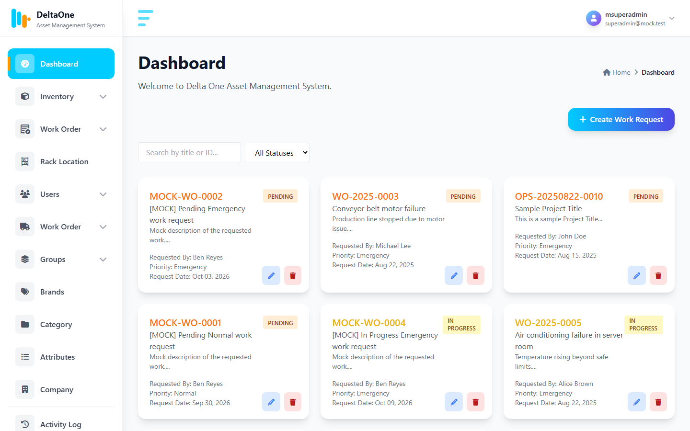

## Screenshots

| | |
|---|---|
| 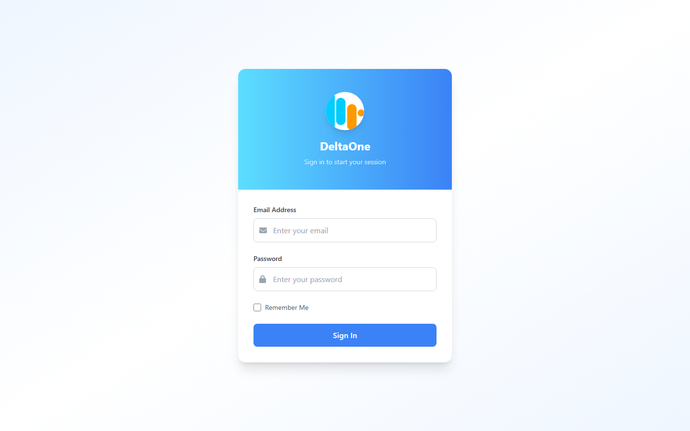 **Login** | 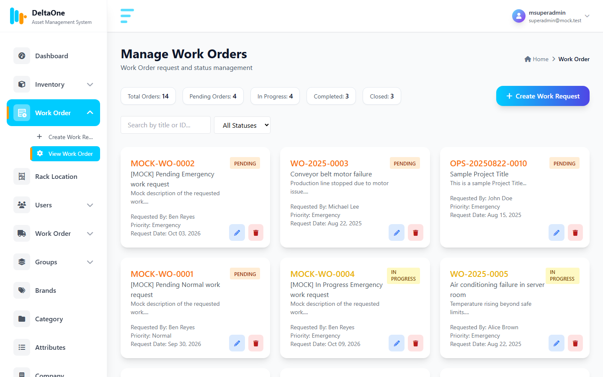 **Work orders** — status counters, search, status filter |
| 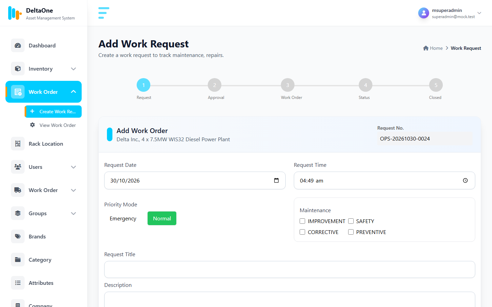 **New work request** — priority, project type, supplies, photos | 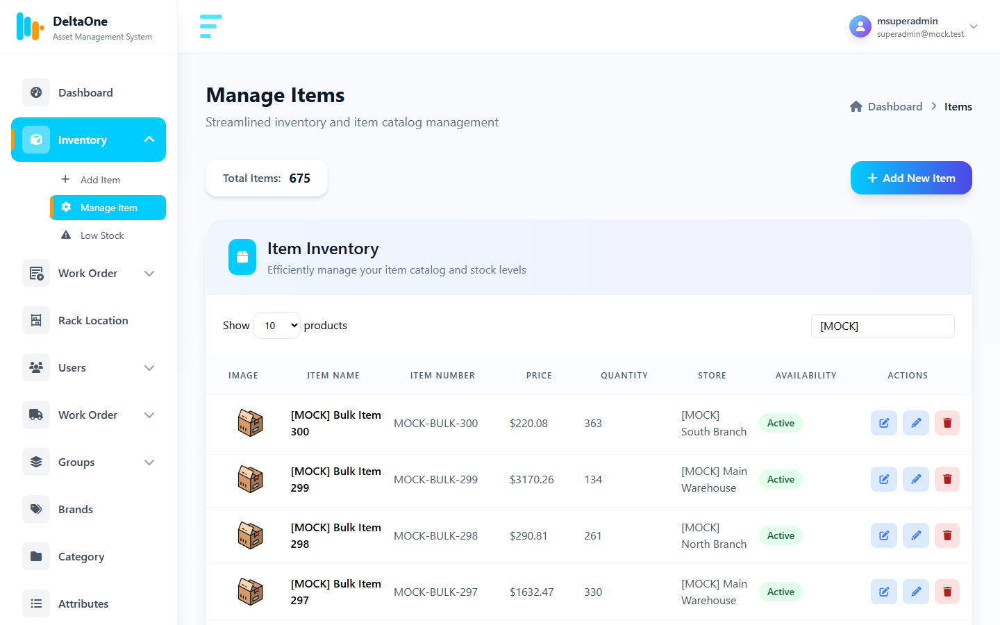 **Inventory** — stock status, store, availability |
| 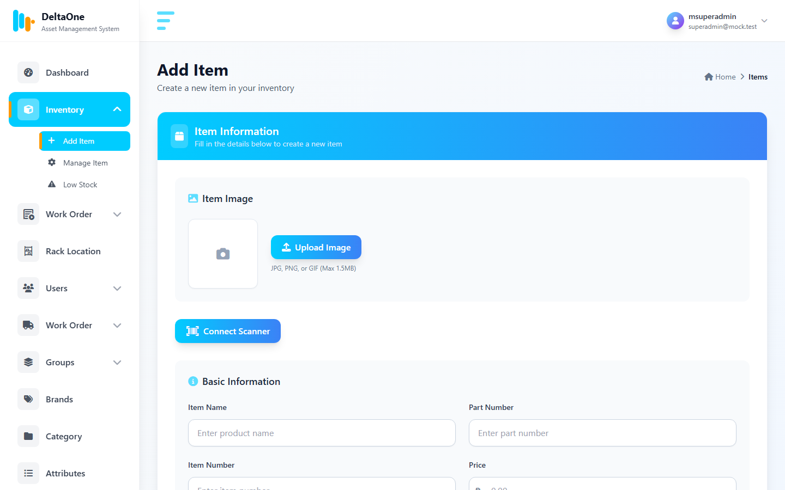 **Add item** — image, part/item number, thresholds, brand, category, attributes | 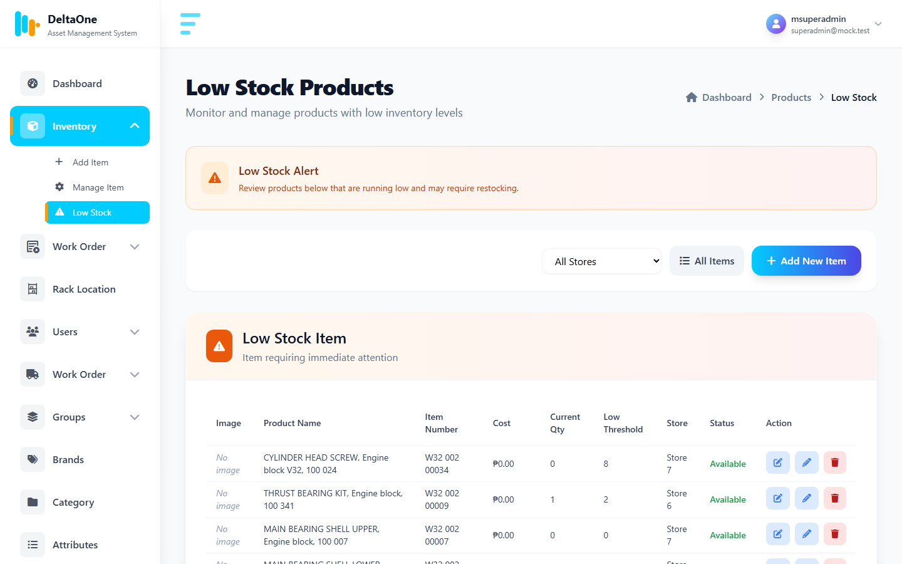 **Low stock** — items at or below their threshold |
| 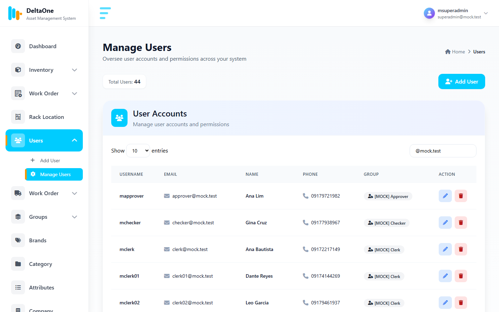 **Users** | 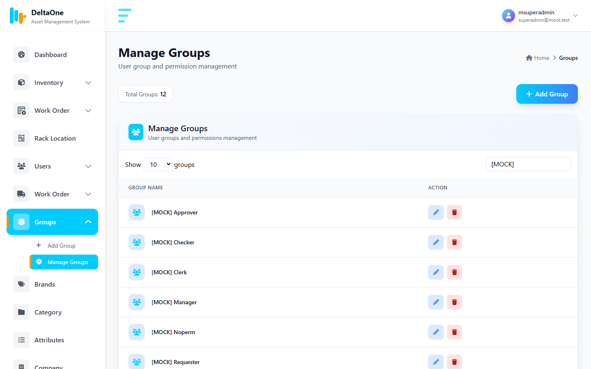 **Groups (roles)** |
| 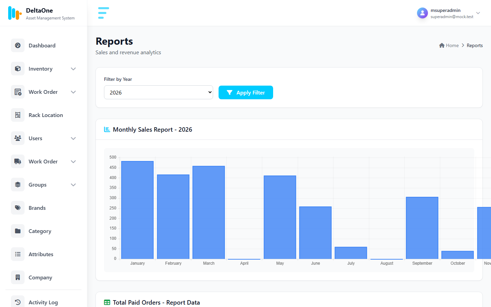 **Reports** — monthly sales by year | 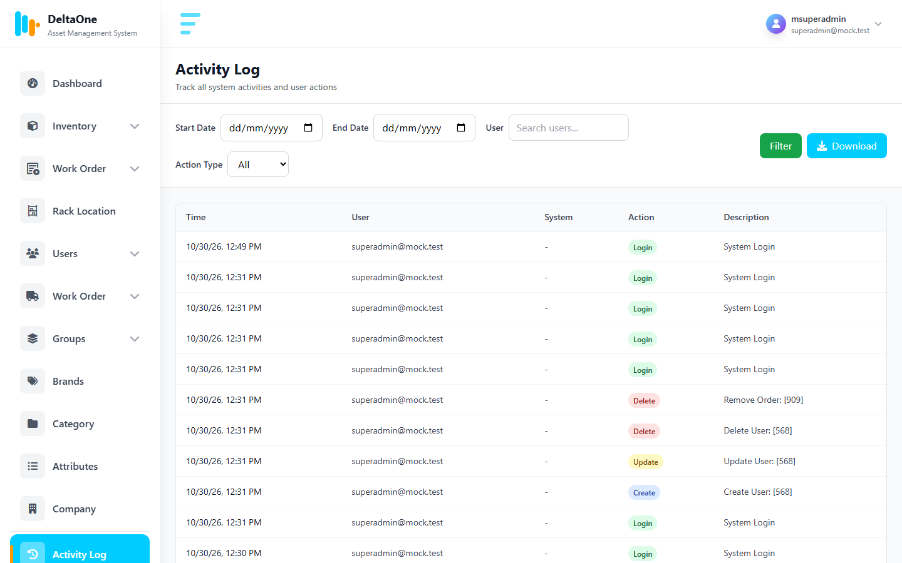 **Activity log** — filter by date, user, action |

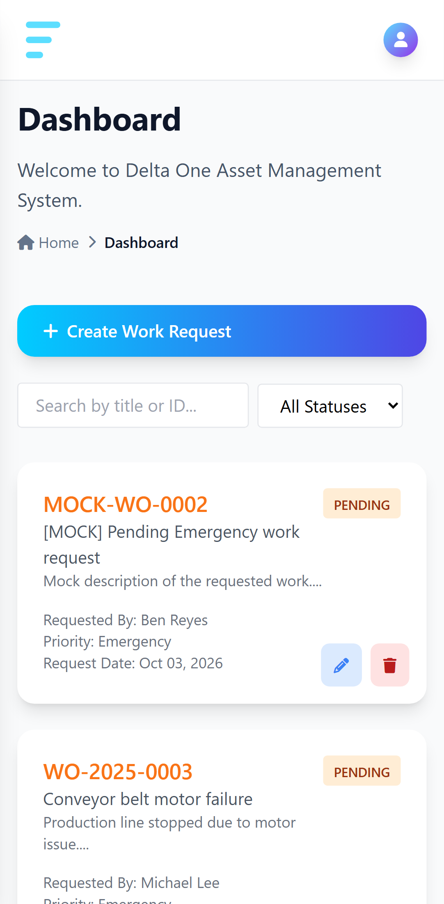 **Responsive** — phone layout

Screenshots show mock data (see [Mock data](#mock-data)); regenerate them with `node scripts/screenshots.mjs`.

## Features

- **Inventory** — items with image, part and item number, price, quantity, low/high stock thresholds, store (rack location), brands, categories and attributes; low-stock page; "Low", "Out of stock" and "Over supply" flags.
- **Work orders** — request → approval → work order → status → closed; Emergency/Normal priority; improvement/safety/corrective/preventive types; supplies drawn from inventory; photo attachments; requester, checker, endorser, receiver, supervisor and approver roles.
- **Master data** — brands, categories, stores (rack locations), attributes and attribute values.
- **Users and groups** — role-based permissions per group (`viewProduct`, `createWorkOrder`, …), profile and personal settings.
- **Orders and reports** — orders with service charge/VAT, printable invoice, yearly sales chart. (Orders are currently hidden from the menu; see [remaining issues](docs/REMAINING_ISSUES.md).)
- **Company settings** — name, address, currency, charges.
- **Activity log** — logins, creates, updates and deletes, with filters.
- **Job-order API** — JSON endpoints under `api/` for an external job-order system, protected by an API key.

## Tech stack

| Layer | |
|---|---|
| Backend | CodeIgniter 3, PHP 7.4 (CodeIgniter 3 does not run on PHP 8) |
| Database | MariaDB 10.4 / MySQL — schema and seed data in `stock.sql` |
| Frontend | Server-rendered views, Tailwind CSS, jQuery, DataTables, Select2, Chart.js |
| Tooling | Docker Compose, Node 18+ for tests (`node:test`, Playwright) |

## Quick start (Docker)

```bash
API_KEY=change-me docker compose up -d --build
```

Open <http://localhost:8080>. The database is created from `stock.sql` on the first start.

The `stock.sql` seed includes an administrator account `admin@admin.com` with the password `password`. **Change it right after the first login**, and do not use the seed data in production.

Environment variables (set them in your shell or a `.env` file next to `docker-compose.yml`):

| Variable | Default | Purpose |
|---|---|---|
| `WEB_PORT` | `8080` | Host port for the app |
| `BASE_URL` | `http://localhost:8080` | CodeIgniter base URL |
| `DB_HOST`, `DB_USER`, `DB_PASS`, `DB_NAME` | `db`, `root`, compose default, `stock` | Database connection |
| `API_KEY` | *(empty)* | Shared key for the `api/` endpoints; empty disables the API |

phpMyAdmin is available on port 8081 with:

```bash
docker compose --profile tools up -d
```

### Upgrading an existing database

Databases created from an older `stock.sql` are missing three columns the code uses (`products.part_number`, `products.high_quantity`, `work_order.signatures`); without them the dashboard fails with *Unknown column 'high_quantity'*. The migration only adds columns and is safe to run more than once:

```bash
docker exec -i deltaone-db-1 sh -c 'mysql -uroot -p"$MYSQL_ROOT_PASSWORD" stock' < database/migrations/2026_10_30_add_missing_columns.sql
```

## Installation without Docker (XAMPP / LAMP)

1. Copy the project into your web root, e.g. `C:\xampp\htdocs\deltaone`.
2. In phpMyAdmin create a database named `stock` and import `stock.sql` (and run the migration above if the database already existed).
3. Set the database password in `application/config/database.php` or via the `DB_*` environment variables, and `BASE_URL` if the folder name differs (default `http://localhost/deltaone`).
4. Start Apache and MySQL and open <http://localhost/deltaone>.

Use PHP 7.4, with `mod_rewrite` and `AllowOverride All` enabled for the `.htaccess` rules.

## Mock data

A seeder creates clearly marked test data: one account per role, 310 products in every stock state, orders across three years, work orders in every status and activity-log entries. It refuses to run without `MOCK_SEED=1` and re-runs only replace rows it created:

```bash
docker exec -e MOCK_SEED=1 deltaone-web-1 php database/seeds/seed_mock_data.php
```

All mock accounts use the password `MockPass123!` (for example `superadmin@mock.test`, `requester@mock.test`, `viewer@mock.test`). Details and the full account list: [docs/MOCK_DATA.md](docs/MOCK_DATA.md).

## Tests

Both suites run against a seeded Docker stack; [docs/TEST_REPORT.md](docs/TEST_REPORT.md) explains the isolated test stack they expect (`docker compose -p deltaone-review`, port 8091).

```bash
npm install
```

HTTP integration tests (48 — auth, every page, permissions, security, business workflows):

```bash
npm run test:http
```

Playwright UI end-to-end tests (35 — real Chromium, desktop and mobile):

```bash
npx playwright install chromium
```

```bash
npm run test:e2e
```

## Job-order API

`api/job_order/{create,get,update,delete}/`, `api/db-rows/…` and `api/manage-column/…` accept JSON and require the header `X-API-Key: <API_KEY>`. Payloads and a Postman collection are in [collection/](collection/README.md).

## Documentation

- [Project review](docs/PROJECT_REVIEW.md) — architecture, modules, findings
- [Bug fixes](docs/BUG_FIXES.md) — what was fixed and why
- [Test report](docs/TEST_REPORT.md) — suites, results, coverage
- [Mock data](docs/MOCK_DATA.md) — seeder and test accounts
- [Remaining issues](docs/REMAINING_ISSUES.md) — known problems and recommendations
- Architecture and process-flow diagrams: `README-Inventory System Architecture-1.eraserdiagram`, `README-Inventory System Process Flow-2.eraserdiagram` ([Eraser workspace](https://app.eraser.io/workspace/m5slGlRfBf7Xmi5HwElp))

## Credits

Based on the open-source Stock Management System v2 by [CodersFolder](https://codersfolder.com/2018/02/stock-management-system-v2-codeigniter/), built with [CodeIgniter](https://codeigniter.com/) and [AdminLTE](https://adminlte.io/).

## License

MIT
